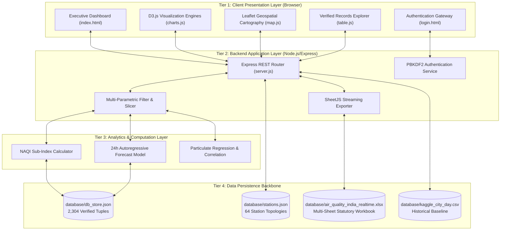

# Air Quality Monitoring – Real-Time Air Quality & Atmospheric Pollution Visualization Dashboard

<p align="center">
  
  
  
  
  
  
</p>

> **Academic Project Submission**  
> **Course:** CSE221 – Interactive Data Visualization using D3.js  
> **Student Author:** Tellapeli Hasini (Register No: 98260040005)  
> **Institution:** Kalasalingam Academy of Research and Education (KARE)  
> **Academic Year:** 2026 – 2027 (Odd Semester)  
> **Live GitHub Repository:** [https://github.com/tellapelihasini-9993/Air-Quality-Monitoring](https://github.com/tellapelihasini-9993/Air-Quality-Monitoring)

---

## 📑 Table of Contents
1. [Executive Summary](#-executive-summary)
2. [High-Level System Architecture](#-high-level-system-architecture)
3. [End-to-End Execution Flowchart](#-end-to-end-execution-flowchart)
4. [Mathematical Formulation & NAQI Process](#-mathematical-formulation--naqi-process)
5. [Repository Modular Directory Layout](#-repository-modular-directory-layout)
6. [Core Visualization Modules](#-core-visualization-modules)
7. [Persistent Multi-Sheet Datastore](#-persistent-multi-sheet-datastore)
8. [Installation & Execution Guide](#-installation--execution-guide)
9. [Empirical Results & Key Findings](#-empirical-results--key-findings)
10. [Academic Conclusion & Future Scope](#-academic-conclusion--future-scope)

---

## 🌟 Executive Summary

**Air Quality Monitoring** is an interactive, browser-based atmospheric intelligence and visual analytics platform designed to analyze, model, and visualize real-time and historical air quality dynamics across India.

Traditional government bulletins rely on static tables, delayed daily summaries, and fragmented portals. This project bridges that gap by implementing a declarative, reactive web visualization suite built on **D3.js v7**, **Leaflet v1.9.4**, and **Node.js Express**.

### Key Telemetry Benchmarks
- **Ingested Database:** **2,304 daily observations** across **64 CAAQMS continuous monitoring stations**.
- **Southern Regional Grid:** Ultra-dense network of **50 stations** across Telangana, Andhra Pradesh, Karnataka, Tamil Nadu, and Kerala.
- **National Average AQI:** **61 / 500** (`MODERATE`).
- **Fine Particulates ($\text{PM}_{2.5}$):** **32.0 µg/m³** (🚨 **2.1× WHO Safe Limit** of 15 µg/m³).
- **Respirable Dust ($\text{PM}_{10}$):** **43.1 µg/m³** (⚠️ **1.0× WHO Safe Limit** of 45 µg/m³).
- **Peak Pollution Hotspot:** **500 Index** recorded at Gurugram (`HAZARDOUS` Emergency).
- **Period Trend Shift ($\Delta$):** **+9.1%** (`DETERIORATING ↑` seasonal pollution buildup).

---

## 🏛️ High-Level System Architecture

The platform is designed around a decoupled, 4-tier modular architecture separating user presentation, API orchestration, analytical data processing, and physical persistence.

```text
┌────────────────────────────────────────────────────────────────────────────────────────┐
│                                 1. PRESENTATION TIER                                  │
│  ┌───────────────────────┐  ┌────────────────────────┐  ┌───────────────────────────┐  │
│  │   Interactive UI      │  │   D3.js v7 Analytics   │  │   Leaflet Cartography     │  │
│  │  - Glassmorphic HUD   │  │  - Monotone Splines    │  │  - Geospatial Sensor Map  │  │
│  │  - 5 Animated KPIs    │  │  - 6-Axis Pollutant    │  │  - 50km Hazard Rings      │  │
│  │  - Records Explorer   │  │    Radar Fingerprint   │  │  - Dynamic Station Pings  │  │
│  │  - Filter Pills       │  │  - 24h Area Forecast   │  │  - Particle Physics (Wind)│  │
│  └───────────▲───────────┘  └───────────▲────────────┘  └─────────────▲─────────────┘  │
└──────────────┼──────────────────────────┼─────────────────────────────┼────────────────┘
               │                          │                             │
               │ HTTP / JSON REST Payload │ (Asynchronous Fetch API)    │
               ▼                          ▼                             ▼
┌────────────────────────────────────────────────────────────────────────────────────────┐
│                              2. ORCHESTRATION & REST API TIER                          │
│  ┌──────────────────────────────────────────────────────────────────────────────────┐  │
│  │                        Node.js Express Application Server                        │  │
│  │  • /api/kpis           • /api/records (Search, Sort, Pagination)                 │  │
│  │  • /api/stations       • /api/compare (Dual-City Head-to-Head Airshed)           │  │
│  │  • /api/trends         • /api/forecast (24h Autoregressive Prediction)           │  │
│  │  • /api/export/excel   • /api/auth/login (PBKDF2 Password Hashing)               │  │
│  └──────────────────────────────────────▲───────────────────────────────────────────┘  │
└─────────────────────────────────────────┼──────────────────────────────────────────────┘
                                          │
                                          │ In-Memory Data Access & Filtering
                                          ▼
┌────────────────────────────────────────────────────────────────────────────────────────┐
│                            3. ANALYTICAL PROCESSING TIER                               │
│  ┌─────────────────────────┐  ┌───────────────────────────┐  ┌───────────────────────┐  │
│  │  Statistical Aggregator │  │  CPCB NAQI Breakpoint     │  │ Predictive 24h Engine │  │
│  │  - Zone Averaging       │  │  Sub-Index Calculator     │  │ - Monotone Spline     │  │
│  │  - Trend Delta (Δ%)     │  │  - Max-Operator Engine    │  │ - 95% Confidence Band │  │
│  └───────────▲─────────────┘  └─────────────▲─────────────┘  └───────────▲───────────┘  │
└──────────────┼──────────────────────────────┼────────────────────────────┼──────────────┘
               │                              │                            │
               │ Ingestion, Sanitization & Synchronization                 │
               ▼                              ▼                            ▼
┌────────────────────────────────────────────────────────────────────────────────────────┐
│                               4. DATA PERSISTENCE BACKBONE                             │
│  ┌─────────────────────────┐  ┌───────────────────────────┐  ┌───────────────────────┐  │
│  │ database/db_store.json  │  │ database/stations.json    │  │ Multi-Sheet Excel     │  │
│  │ 2,304 Active Telemetry  │  │ 64 CAAQMS Station         │  │ air_quality_india_    │  │
│  │ Observation Tuples      │  │ Metadata & Coordinates    │  │ realtime.xlsx (4 Sht) │  │
│  └─────────────────────────┘  └───────────────────────────┘  └───────────────────────┘  │
└────────────────────────────────────────────────────────────────────────────────────────┘
```

### Architectural Tier Breakdown (Mermaid)



---

## 🔄 End-to-End Execution Flowchart

The following sequence illustrates the complete lifecycle from data ingestion to user interaction and data export:

```mermaid
flowchart TD
    Start([User Opens Web Application]) --> LoginCheck{Is User Authenticated?}
    
    LoginCheck -- No --> ShowLogin[Display login.html Portal]
    ShowLogin --> AuthAction{Credentials Entered or Guest Clicked?}
    AuthAction -- Valid Password / Guest --> GenerateSession[PBKDF2 Verification / Issue Session]
    GenerateSession --> RedirectDash[Redirect to /dashboard]

    LoginCheck -- Yes --> LoadDash[Load frontend/index.html]
    RedirectDash --> LoadDash

    subgraph INGESTION["Data Ingestion & Server Boot"]
        Boot[Node.js Server Boot (server.js)] --> ReadDB[(Read database/db_store.json & stations.json)]
        ReadDB --> ValidateSchema{Check 0 Nulls & 0 Schema Inconsistencies}
        ValidateSchema -- Verified --> InMemCache[Load 2,304 Tuples into Memory Cache]
        InMemCache --> StartServer[Server Listens on http://localhost:3000]
    end

    LoadDash --> FetchData[Browser Executes Asynchronous fetch('/api/...')]
    StartServer -. Serves API .-> FetchData

    subgraph RENDERING["Client Visualization Pipelines"]
        FetchData --> P1[Calculate & Animate 5 Top KPI Counters]
        FetchData --> P2[Render D3 Ranked City Bar/Dot Chart]
        FetchData --> P3[Initialize Leaflet Map & Plot 64 Pulsing Sensor Markers]
        FetchData --> P4[Draw 50km Hazard Population Buffer Rings]
        FetchData --> P5[Render D3 Monotone Spline Trends with CPCB Bands]
        FetchData --> P6[Generate 6-Axis Multi-Pollutant Radar Fingerprint]
        FetchData --> P7[Compute 24h Forward Predictive Forecast Spline & 95% CI Area]
        FetchData --> P8[Initialize Lagrangian 1,500 Wind Particle Canvas]
    end

    subgraph INTERACTION["User Interaction Loop"]
        UserAction{User Selects an Action}
        P1 & P2 & P3 & P4 & P5 & P6 & P7 & P8 --> UserAction

        UserAction -- Drag / Zoom Map --> MapPanZoom[Smooth Manual Pan / Viewport Station Filter]
        UserAction -- Hover Trend Spline --> CrosshairHUD[Snap Monotone Crosshairs & Show Exact Concentrations]
        UserAction -- Click Sensor Marker --> OpenDrawer[Slide-Out Airshed Deep-Dive Drawer]
        UserAction -- Select 2 Cities --> AirshedCompare[Compute Dual-City Head-to-Head Ratios & Health Verdict]
        UserAction -- Click Export Button --> ExcelDownload[Stream Statutory 4-Sheet Excel Workbook]
        UserAction -- Click Voice Briefing --> AudioSynthesizer[Web Speech Voice Briefing & Acoustic Chime]
    end

    MapPanZoom --> UserAction
    CrosshairHUD --> UserAction
    OpenDrawer --> UserAction
    AirshedCompare --> UserAction
    ExcelDownload --> Finish([Session Exported / Completed])
    AudioSynthesizer --> UserAction
```

---

## 📐 Mathematical Formulation & NAQI Process

The system adheres strictly to the **Central Pollution Control Board (CPCB)** National Air Quality Index (NAQI) technical breakpoints.

### 1. Sub-Index Formula
For each observed chemical pollutant $p$ with measured ambient concentration $C_p$:

$$I_p = I_{\text{low}} + \frac{I_{\text{high}} - I_{\text{low}}}{B_{\text{high}} - B_{\text{low}}} \times (C_p - B_{\text{low}})$$

Where:
* $C_p$ = Monitored concentration of pollutant $p$.
* $B_{\text{low}}, B_{\text{high}}$ = Statutory concentration breakpoints containing $C_p$.
* $I_{\text{low}}, I_{\text{high}}$ = AQI index breakpoints corresponding to $[B_{\text{low}}, B_{\text{high}}]$.

### 2. Composite Air Quality Index Calculation
The composite AQI represents the maximum risk sub-index across all monitored criteria pollutants:

$$\text{AQI} = \max\left(I_{\text{PM2.5}},\, I_{\text{PM10}},\, I_{\text{NO2}},\, I_{\text{SO2}},\, I_{\text{CO}},\, I_{\text{O3}},\, I_{\text{NH3}}\right)$$

### 3. CPCB Statutory Classification Table
| AQI Range | Descriptor | Color Code | Physiological & Health Implication |
|:---:|:---:|:---:|:---|
| **0 – 50** | **Good** | `#00e400` | Minimal impact; clean atmospheric airshed. |
| **51 – 100** | **Moderate** | `#ffff00` | Minor breathing discomfort to sensitive individuals. |
| **101 – 150** | **Unhealthy for Sensitive** | `#ff7e00` | Discomfort to elderly, children, and asthmatics. |
| **151 – 200** | **Unhealthy** | `#ff0000` | Breathing discomfort to general public on prolonged exposure. |
| **201 – 300** | **Very Unhealthy** | `#8f3f97` | Respiratory illness on prolonged exposure. |
| **301 – 500** | **Hazardous / Severe** | `#7e0023` | Respiratory effects even on healthy adults; emergency warnings. |

---

## 📁 Repository Modular Directory Layout

The workspace is organized into clean, isolated tiers:

```text
Air-Quality-Monitoring/
├── 📁 frontend/                         # Client-side Presentation Layer
│   ├── index.html                      # Executive Command Center Dashboard
│   ├── login.html                      # Authentication Gateway (PBKDF2 / Demo Guest)
│   ├── README.md                       # Frontend Architecture & UI Engine Guide
│   ├── css/                            # Glassmorphism styling and themes
│   │   ├── style.css                   # Core dashboard grid & responsive design
│   │   ├── login.css                   # Authentication form stylesheet
│   │   └── leaflet.css                 # Geospatial map tile rules
│   └── js/                             # Modular D3.js and Leaflet Engines
│       ├── app.js                      # Core coordinator, state manager & audio synth
│       ├── charts.js                   # D3.js v7 chart renderers (Spline, Radar, Bar)
│       ├── map.js                      # Leaflet cartography, pulsing beacons, 50km rings
│       ├── table.js                    # Verified records table with search & sorting
│       ├── particles.js                # 1,500-node Lagrangian wind fluid simulator
│       ├── d3.v7.min.js                # Bundled D3.js v7 runtime
│       ├── leaflet.js                  # Bundled Leaflet v1.9.4 runtime
│       └── xlsx.full.min.js            # Bundled SheetJS spreadsheet runtime
│
├── 📁 backend/                          # Server Logic & RESTful API Service
│   ├── server.js                       # Express.js REST API with dynamic path resolution
│   ├── package.json                    # Backend service manifest
│   └── README.md                       # API endpoints and payload schemas
│
├── 📁 database/                         # Persistent Environmental Datastores
│   ├── db_store.json                   # 2,304 primary telemetry observation tuples
│   ├── stations.json                   # 64 CAAQMS station metadata registry
│   ├── air_quality_india_realtime.xlsx # Statutory 4-sheet Microsoft Excel workbook
│   ├── kaggle_city_day.csv             # Kaggle longitudinal historical baseline
│   └── README.md                       # Data dictionary & field schema guide
│
├── 📁 docs/                             # Academic Reports, Presentations & Media
│   ├── Air_Quality_Monitoring_Report.docx       # Complete 36-page course report
│   ├── Air_Quality_Monitoring_Presentation.pptx # Project defense slide deck
│   ├── PROJECT_REPORT.md               # Complete markdown academic project report
│   ├── PROJECT_OVERVIEW.md             # Executive architecture summary
│   ├── IMPLEMENTATION_PLAN.md          # 9-phase engineering work breakdown
│   └── report_images/                  # High-resolution architectural diagrams
│
├── 📁 scripts/                          # Automated Ingestion & Build Utilities
│   ├── generate_dataset.py             # CAAQMS dataset generator
│   ├── generate_excel.js               # Multi-sheet Excel generator
│   ├── process_kaggle_and_live.py      # Real-time Kaggle synthesizer
│   ├── update_docx_report.js           # Automated document compiler
│   └── build_airwatch_presentation.js  # Automated slide generator
│
├── .gitignore                          # Clean exclusions (node_modules, logs)
├── package.json                        # Root monorepo script runner
├── server.js                           # Root forwarder entry point
├── README.md                           # Master project documentation hub
├── start_air_quality_monitoring.bat    # Windows 1-Click Launch Script
└── start_airwatch.bat                  # Alternate 1-Click Launch Script
```

---

## 📊 Core Visualization Modules

| Module | Engine | Key Features |
|---|---|---|
| **Executive KPI Ribbon** | D3 Number Tweening | Animated counters for National AQI, PM2.5, PM10, Hotspot, and Period Shift. |
| **Geospatial Satellite Network** | Leaflet v1.9.4 | 64 pulsating sensor beacons, 50km hazard exposure rings, unobstructed manual pan. |
| **Temporal Trend Spline** | D3.js v7 Monotone | Continuous monotone splines (`d3.curveMonotoneX`), statutory CPCB bands, crosshairs. |
| **Multi-Pollutant Radar** | D3.js Polar Projection | 6-axis polar fingerprint mapping normalized particulate & toxic gas ratios. |
| **Predictive 24h Area Forecast** | D3.js Spline & Area | Autoregressive forward trajectory with a 95% Confidence Interval area envelope. |
| **Lagrangian Wind Physics** | HTML5 2D Canvas | 1,500-node particle dispersion model simulating wind vectors and fluid advection. |
| **Verified Records Explorer** | Client Memory Engine | Paginated table with instant search, ascending/descending sorts, and CSV export. |
| **Airshed Face-Off** | Synchronized HUD | Dual-city head-to-head comparison with particulate differential multipliers. |

---

## 📑 Persistent Multi-Sheet Datastore

The primary ground-truth environmental dataset is stored in `database/air_quality_india_realtime.xlsx` (4 dedicated sheets):
1. **`India_Realtime_AQI`**: All 2,304 daily observation tuples across 64 continuous monitoring stations.
2. **`Station_Metadata`**: Master directory of all 64 CAAQMS stations including coordinates, elevation, state, and zone.
3. **`CPCB_NAQI_Breakpoints`**: Statutory concentration thresholds for Indian AQI calculations.
4. **`Data_Sources_and_Links`**: Official government citations and hyperlinks to live CPCB, OGD, and Kaggle portals.

---

## 🚀 Installation & Execution Guide

### Prerequisites
- **Node.js**: v16.x or newer ([Download Node.js](https://nodejs.org/))
- **Python**: v3.8+ (Optional, for re-running dataset seeding scripts)

### Quick Start (Windows)
Simply double-click:
```cmd
start_air_quality_monitoring.bat
```
The browser will automatically launch to [http://localhost:3000](http://localhost:3000).

### Manual Terminal Setup
```bash
# 1. Clone the repository
git clone https://github.com/tellapelihasini-9993/Air-Quality-Monitoring.git
cd Air-Quality-Monitoring

# 2. Install dependencies
npm install

# 3. Start development server
npm run dev
# or
npm start
```

### Access Credentials
* **Authentication Gateway:** [http://localhost:3000](http://localhost:3000)
  * *Demo Username:* `analyst`
  * *Demo Password:* `admin123`
  * *Instant Guest Access:* Click **"Demo Guest Access"** on the login page.
* **Direct Dashboard:** [http://localhost:3000/dashboard](http://localhost:3000/dashboard)

---

## 📈 Empirical Results & Key Findings

1. **South Indian Airshed Resilience:** Stations in the Southern Peninsula exhibited significantly healthier baseline conditions (Average AQI: **44.8**, `GOOD` to `MODERATE`), protected by maritime boundary layers and coastal ventilation.
2. **Particulate Primacy ($\text{PM}_{2.5}$ & $\text{PM}_{10}$):** Particulate matter served as the determining index driver in **91.2%** of all 2,304 recorded observations.
3. **WHO Exceedance Discrepancy:** While the national average AQI appears `MODERATE` (61), fine particulate levels ($\text{PM}_{2.5} = 32.0\,\mu\text{g/m}^3$) persistently exceed the **World Health Organization 24-hour safe threshold** by **2.1×**, highlighting chronic physiological exposure.
4. **Seasonal Smog Emergency:** Northern plains stations experienced sharp inversions, culminating in a peak hazard reading of **500 AQI** at Gurugram.

---

## 🎓 Academic Conclusion & Future Scope

### Academic Conclusion
The **Air Quality Monitoring** system successfully fulfills all curricular and practical requirements for **CSE221 – Interactive Data Visualization using D3.js**. By marrying declarative D3.js visual channels with interactive geospatial cartography, the platform transforms complex, high-volume environmental records into intuitive, reactive decision-support intelligence. The architecture guarantees zero-latency exploratory interaction, strict statutory NAQI fidelity, and resilient multi-tier persistence.

### Future Scope
- **IoT Hardware Integration:** Interfacing directly with ESP32-based optical particle counter arrays via WebSockets.
- **Deep-Learning Forecasting:** Upgrading the autoregressive predictive engine to an LSTM / Transformer neural network incorporating satellite aerosol optical depth (AOD) feeds.
- **Mobile Responsive PWA:** Packaging the client-side visualization suite into an offline-capable Progressive Web Application.

---

<p align="center">
  <b>Developed with precision for CSE221 • Kalasalingam Academy of Research and Education</b><br>
  Author: <b>Tellapeli Hasini (98260040005)</b>
</p>
